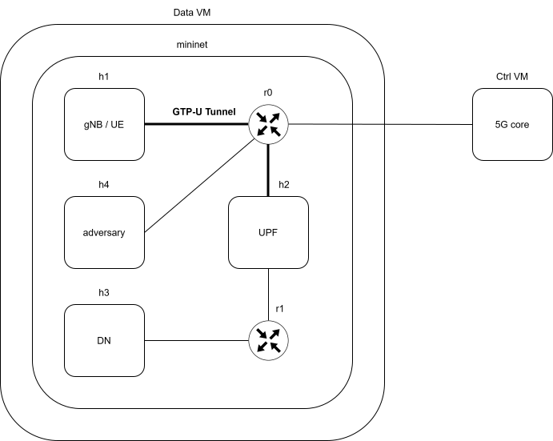
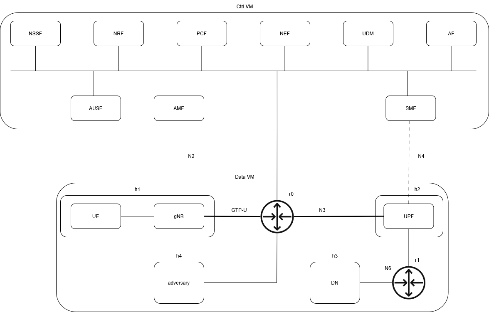

# Network Traffic Data Generation for ML-Based Attack Detection in 5G Networks
This is a step-by-step guide to reproduce the project. You can either deployed directly without configuration or you can configure the environment for yourselves.

## Disclaimer
This project is intended for research and educational purposes only. It runs
in an isolated, simulated 5G environment (free5GC + local VMs) and is not
designed for use against any real or production network. Use it only in
lab setups you own or are authorized to test.

## Overview
This work was produced as a Masters Project by Students form the University of Zurich. The goal was to provide a easy deployable framework for creating a 5G environment with realistic traffic generation. To demonstrate its value a deep learing (DL) pipeline was designed and tested. As a starting point for the development [mini-5g](https://github.com/elavinal/mini-5g) was used.
### Key features
- Uses [free5gc](https://free5gc.org/) and [UERANSIM](https://github.com/aligungr/UERANSIM)
- GTP-U tunnel
- UE need to go through UPF for internet access
- Software Defined Networks (SDN)
- Real benign traffic (TCP Python Sockets, Video and Audio Streaming, Webbrowsing and Pings)
- Multiple Flooding Attacks targeting different Interfaces (N2, N3, N4, N6)

## Table of Contents  
- [Overview](#overview)
- [Topology](#topology)
- [Requirements](#requirements)
- [Installation & Deployment](#installation--deployment)
- [Manual Setup](#manual-setup)
- [Traffic Generation](#traffic-generation)
- [Known Limitations](#known-limitations)
- [Appendix](#appendix)

## Topology

#### Legend
Abbreviation | Explaination 
------------- | -------------
h1 | UE: User Equipment (e.g. a phone) and gNB: Next Generation NodeB (e.g. a celltower)
h2 | UPF: User Plane Function, handles data forwarding and internet gateway
h3 | DN: Data Network (e.g. Internet)
h4 | Adversary, can be used for malicious intent
r0 | Router for packet capturing between gNB and UPF and communication to 5G Core
r1 | Router for packet capturing between UPF and DN
Data VM | Deploys mininet with UERANSIM and free5GC components
Ctrl VM | 5G Core, handles essential functions (AMF, SMF, etc.) with the help of free5GC
GTP-U | Tunnel for carring user data, between gNodeB and UPF

#### High-level description
The UE connects to the gNB, authenticated by the AMF. Normally this occurs over a radio link, but in our simulation both UE and gNB run on the same host (h1). Therefore, we do not have a radio link, like in a real 5G network. 
  
When the UE wants to access the internet, its data flows through the GTP-U tunnel from the gNB (h1) via the router (r0) to the UPF (h2). Ultimatively reaching the DN (h3).

The adversary (h4) has no special setup, it is just a simple host.
  
It is worth noting that the design with the VMs serves the concept of Software Defined Networks (SDN). The vm-ctrl with its 5G Core components represents the control plane. Whereas UPF, which is normally a part of the 5G Core, represents the data plane in the Data VM. This was done for better scalability, security and manageability.

Further details can be found in the [Appendix](#appendix).

## Requirements
### System
- OS: Windows 11
- RAM: +16GB
- CPU: Intel i5 13th Gen or better
### Software
[Install vagrant](https://developer.hashicorp.com/vagrant/install)  
[Install git](https://git-scm.com/downloads)  
[Install VirtualBox](https://www.virtualbox.org/wiki/Downloads) or use another hypervisor  
[Install VcXsrv](https://github.com/marchaesen/vcxsrv/releases)

## Installation & Deployment
You can either start here and have the 5G Environment setup. Or you can go to [Manual Setup](#manual-setup) and start building form there.
Please follow the instructions chronologically.
### Installation (automatic)
#### Install vagrant VMs
   1. Go to your the vagrant folder of this repository
   2. Go to the ctrl-vm subfolder, run the following command and wait until finished
   ```bash
      vagrant up
   ```
   3. Open a second terminal
   4. Go to the data-vm subfolder, run the following command and wait until finished
   ```bash
      vagrant up
   ```
   5. Wait until the VM is setup. You can see it in your hypervisor.
   6. Connect to the VMs
   ```bash
      vagrant ssh
   ```
   Now your 5G simulation environment is ready. In case you encounter any issues run ```vagrant destroy``` and then again ```vagrant up```. If everything works fine but you cannot see the contents of the vagrant folder, do ```vagrant relaod```.
### Deployment
Please follow the order chronologically.
#### data-vm
1. Startup VcXsrv (XLaunch App)
   1. Click two times next
   2. Enable "Disable access control"
   3. Finish
2. Enable xterm windows on your local client
   ```bash
   export DISPLAY=<YOUR_LOCAL_IP_ADDRESS>:0.0
   ```
3. Start-up mininet
   ```bash
   cd ~/mini-5g/
   sudo -E python3 5g-network.py
   xterm h1 h1 h1 h2
   ```
4. In h2 xterm window
   ```bash
   cd ~/free5gc
   ./run.sh
   ```

#### ctrl-vm
```bash
sudo ip route add 192.168.1.0/24 via 192.168.56.20 dev enp0s8
sudo ip route add 192.168.2.0/24 via 192.168.56.20 dev enp0s8
sudo ip route add 192.168.4.0/24 via 192.168.56.20 dev enp0s8
cd ~/free5gc
./run.sh
```

#### data-vm
1. h1 xterm window
```bash
cd ~/UERANSIM/build
./nr-gnb -c ../config/free5gc-gnb.yaml
```
2. In another h1 xterm window
```bash
cd ~/UERANSIM/build
./nr-ue -c ../config/free5gc-ue.yaml
```
3. In another h1 xterm window
```bash
sudo ip r add 192.168.3.0/24 dev uesimtun0
```
## Manual Setup
### Setup & Installation
#### Install mini-5g
   1. Go to your desired location where you want to store your VMs of this project
   2. ```bash
      git clone https://github.com/elavinal/mini-5g.git
      ```
   3. ```bash
      # Startup vm-ctrl
      cd .\mini-5g\vm-ctrl\
      vagrant up
      ```
   4. Wait until the VM is setup. You can see it in your hypervisor.
   5. Open a second terminal
   6. ```bash
      # Startup vm-data
      cd .\mini-5g\vm-data\
      vagrant up
      ```
   7. ```bash
      # Connect to the VMs in the corresponding folder, if not already done
      vagrant ssh
      ```

### Configuration
#### ctrl-vm
1. Prerequisites for the webconsole
    1. Install nodejs
       ```bash
       curl -fsSL https://deb.nodesource.com/setup_20.x | sudo -E bash - 
       sudo apt update
       sudo apt install -y nodejs
       sudo npm install --global npm@11.8.0
       sudo npm install --global yarn
       ```
    2. Build the webconsole
     ```bash
     cd ~/free5gc
     make webconsole
     ```
    3. Register UE
        1. Run the webconsole
           ```bash
           cd ~/free5gc/webconsole
           ./bin/webconsole
           ```
        2. Visit IP_ADDRESS_OF_vm-ctrl:5000 in your browser
        3. You should see now a sign in screen
        4. Username: admin
           Password: free5gc
        5. Go to subscribers
        6. Add a new subscriber
        8. Change the opType to 'OP'
        7. Explaination of the entries
           1. PLMN ID = mcc+mnc (concatenated)
           2. SUPI (IMSI) = the supi-number, without the "imsi-"-part
           3. k = key
           4. Operator Code Type = opType
           5. Operator Code Value = op
        7. Make a photo or scrennshot of the subscriber data
        8. Submit
        9. Ctrl + c in the terminal to abort the webconsole
        10. Adjuist SMF config (set UPF nodeID: 192.168.2.2)
            ```bash
            cd ~/free5gc/config/
            cp smfcfg.yaml smfcfg.old.yaml
            nano smfcfg.yaml
            ```
        11. Copy the subfolder "traffic_generation" of this repository into the home folder.
            ```bash
            # Copy the traffic_generation folder into the folder where you typed vagrant up
            cd /vagrant/
            sudo cp -r traffic_generation /home/vagrant
            ```
#### data-vm
1.  Install nodejs
    ```bash
    curl -fsSL https://deb.nodesource.com/setup_20.x | sudo -E bash - 
    sudo apt update
    sudo apt install -y nodejs
    sudo npm install --global npm@11.8.0
    sudo npm install --global yarn
    ```
2. Put the 5g-network.py file in the vagrant folder of the vm-data
3. ```bash
    # Backup UERANSIM
    cd
    cp -r UERANSIM UERANSIM_old
    ```
4. Update cmake
    ```bash
    sudo pip install --upgrade cmake
    ```
5. Checkout and make correct UERANSIM commit
   ```bash
    cd ~/UERANSIM
    sudo apt update
    git checkout -f 3a96298
    make
    ```
6. Correct IMSI of UE (correspond with subscriber of the photo of earlier)
    ```bash
    cd ~/UERANSIM/config/
    cp free5gc-ue.yaml free5gc-ue.old.yaml
    nano free5gc-ue.yaml
    ```
7. Adjust gNB config (set ngapIp: 192.168.1.1 and AMF address: 192.168.56.10)
    ```bash 
    cd ~/UERANSIM/config/
    cp free5gc-gnb.yaml free5gc-gnb.old.yaml
    nano free5gc-gnb.yaml
    ```
8. Adjust UPF config (pfcp addr: 192.168.2.2 and nodeID: 192.168.2.2)
    ```bash
    cd ~/free5gc/config/
    cp upfcfg.yaml upfcfg.old.yaml
    nano upfcfg.yaml
    ```
9. Copy the subfolder "traffic_generation" and the file "5g-network.py" of this repository into the home folder.
    ```bash
    # Copy the traffic_generation folder into the folder where you typed vagrant up
    cd /vagrant/
    sudo cp -r traffic_generation /home/vagrant
    sudo cp 5g-network.py /home/vagrant/mini-5g
    ```

If you want to generate traffic with this frame work or launch attack, please checkout their prerequisites in their corresponding chapters. Else checkout the [Deployment](#deployment) subchapter.


## Traffic Generation
1. Create subfolders for the generated packets in both VMs (only for manual setup needed).
    ```bash
    mkdir /vagrant/traffic_capture/
    mkdir /vagrant/traffic_capture/benign/
    mkdir /vagrant/traffic_capture/attack/
    ```
### Benign
Please follow always the order of the steps. Each benign simulation always runs for exactly four hours.
1. Install prerequisite in the data-vm (only for manual setup needed).
    ```bash
    sudo apt update
    sudo apt -y install ffmpeg
    cd ~/traffic_generation/benign/UE
    sudo apt -y install libatk1.0-0 libatk-bridge2.0-0 libcups2 libxcomposite-dev libxdamage1 libgbm-dev
    cd ~/traffic_generation/benign/UE
    sudo npm init -y
    sudo npm i puppeteer
    sudo apt -y install nginx
    ```
#### Gaming
1. r0
    ```bash
    cd /vagrant/traffic_capture/benign/
    sudo tcpdump -i any -w gaming_r0.pcap
    ```
2. r1
    ```bash
    cd /vagrant/traffic_capture/benign/
    sudo tcpdump -i any -w gaming_r1.pcap
    ```
3. h3
    ```bash
    cd ~/traffic_generation/benign/DN
    sudo -E python3 ./game_server.py
    ```
4. h1
    ```bash
    cd ~/traffic_generation/benign/UE
    sudo -E python3 ./game_client.py
    ```
#### Webbrowsing
1. In package.json, set "type": "module"
2. r0
    ```bash
    cd /vagrant/traffic_capture/benign/
    sudo tcpdump -i any -w webbrowsing_r0.pcap
    ```
3. r1
    ```bash
    cd /vagrant/traffic_capture/benign/
    sudo tcpdump -i any -w webbrowsing_r1.pcap
    ```
4. h3 run webserver
    ```bash
    nginx
    ```
5. h1
    ```bash
    cd ~/traffic_generation/benign/UE
    node webbrowsing.js
    ```

#### Ping
1. r0
    ```bash
    cd /vagrant/traffic_capture/benign/
    sudo tcpdump -i any -w ping_r0.pcap
    ```
2. r1
    ```bash
    cd /vagrant/traffic_capture/benign/
    sudo tcpdump -i any -w ping_r1.pcap
    ```
3. h1
    ```bash
    cd ~/traffic_generation/benign/UE
    sudo -E python3 ./ping_traffic.py
    ```

#### Streaming
1. r0
    ```bash
    cd /vagrant/traffic_capture/benign/
    sudo tcpdump -i any -w streaming_r0.pcap
    ```
2. r1
    ```bash
    cd /vagrant/traffic_capture/benign/
    sudo tcpdump -i any -w streaming_r1.pcap
    ```
3. h1
    ```bash
    cd ~/traffic_generation/benign/UE
    sudo -E python3 ./video_stream_client.py
    ```
4. h3
    ```bash
    cd ~/traffic_generation/benign/DN
    sudo -E python3 ./video_stream_server.py
    ```

### Attack
Since we were not able to capture all traffic in the case of N2-, N3- and N4-flooding. We needed to reduce the rate of sending the packets as well as increase the buffersize for packet capture. 
Additionally, each attack can either be done for three, six or ten minutes. To choose the duration you can set the last parameter of the python script to short, medium or long.
1. Install prerequisites on both VMs (only for manual setup needed)
    ```bash
    sudo apt update
    sudo apt install tcpreplay
    sudo apt install -y hping3
    ```
2. Copy the subfolder "traffic_generation" of this repository into the ctrl-vm and data-vm. (only for manual setup needed)

#### N6
The N6 interface connects the UPF to the data network. It forwards traffic e.g. to a webserver.
1. r1
    ```bash
    cd /vagrant/traffic_capture/attack/
    sudo tcpdump -i any -w n6_flooding_<DURATION>.pcap
    ```
2. h2
    ```bash
    cd ~/traffic_generation/attack
    sudo -E python3 ./attack_traffic.py 192.168.3.3 N6 <DURATION>
    ```

#### N4
The N4 interface lies between the SMF of the 5G Core and UPF. SMF uses PFCP to control the UPF. 
1. ctrl-vm
    ```bash
    cd /vagrant/traffic_capture/attack/
    sudo tcpdump -i any -w n4_flooding_<DURATION>.pcap
    ```
2. ctrl-vm
    ```bash
    cd ~/traffic_generation/attack
    sudo -E python3 ./attack_traffic.py 192.168.2.2 N4 <DURATION>
    ```

#### N3
The N3 interface lies between RAN and UPF. It consists out of GTP-U tunnels. For each UE one dedicated tunnel.

In the case of N3 flooding you can choose between gtp/tcp, gtp/udp or gtp/icmp flooding. This can be done in setting the second parameter of the attack script to N3_ICMP, N3_TCP or N3_UDP.
1. r0
    ```bash
    cd /vagrant/traffic_capture/attack/
    sudo tcpdump -i any -s 0 -B 131072 -w n3_<PROTOCOL>_flooding_<DURATION>.pcap
    ```
2. h1
    ```bash
    cd ~/traffic_generation/attack
    sudo -E python3 ./attack_traffic.py 192.168.2.2 N3_<PROTOCOL> <DURATION>
    ```

#### N2
The N2 interface lies between RAN and AMF of the 5G Core. The purpose is to hande control plane signaling. The gNB uses for that purpose NGAP over SCTP.
1. r0
    ```bash
    cd /vagrant/traffic_capture/attack/
    sudo tcpdump -i any -w n2_flooding_<DURATION>.pcap
    ```
2. h1
    ```bash
    cd ~/traffic_generation/attack
    sudo -E python3 ./attack_traffic.py 192.168.56.10 N2 <DURATION>
    ```

## Known Limitations
- Caturing of the (N2, N3, N4)-floodings needed to be reduced in rate, else we were not able to capture the packets properly.
- No radio signal

# Appendix
## 5G Service testbed
For further clarificaiton and explaination of the environment. The host (r0) serves as a gateway to the Ctrl VM. Therefore it sees all the traffic from and to the Ctrl VM. In addition to that it can capture the GTP packets.

### Legend
Abbreviation | Explaination 
------------- | -------------
UPF | User Plane Function. Handles data forwarding and internet gateway 
AMF | Access and Mobility Management Function. UE registration, mobility, and connection management. (From gNB to AMF)
SCTP | Stream Control Transmission Protocol. Reliable transport protocol used for signaling between network elements (e.g. between gNB and AMF)
NGAP | Next Generation Application Protocol. Control plane protocol between gNB and AMF for signaling (runs over SCTP)
SMF | Session Management Function. Manages PDU sessions Manages, sets up GTP-U tunnels and configures UPF
PFCP | Packet Forwarding Control Protocol. Used by SMF to control UPF. (From SMF to UPF)
PDU | Protocol Data Unit. Each logical data session (PDU) has a corresponding GTP-U tunnel for a UE

